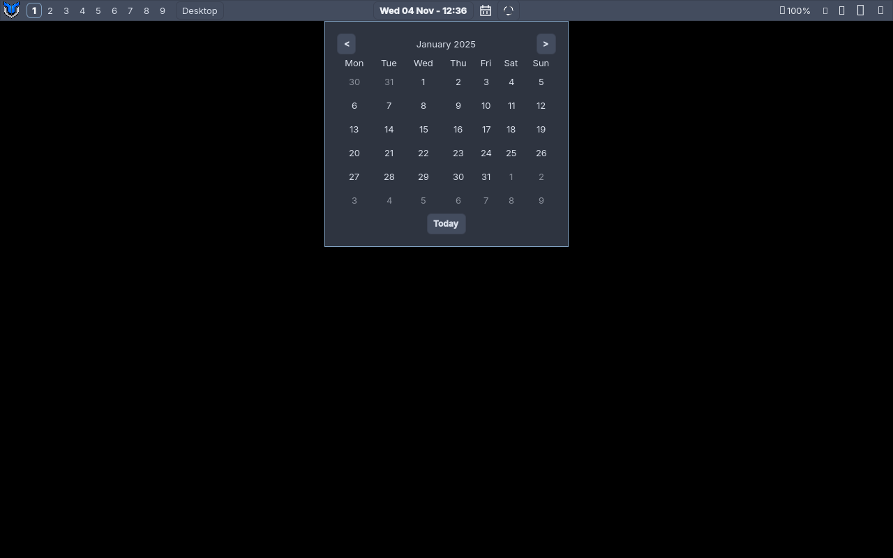
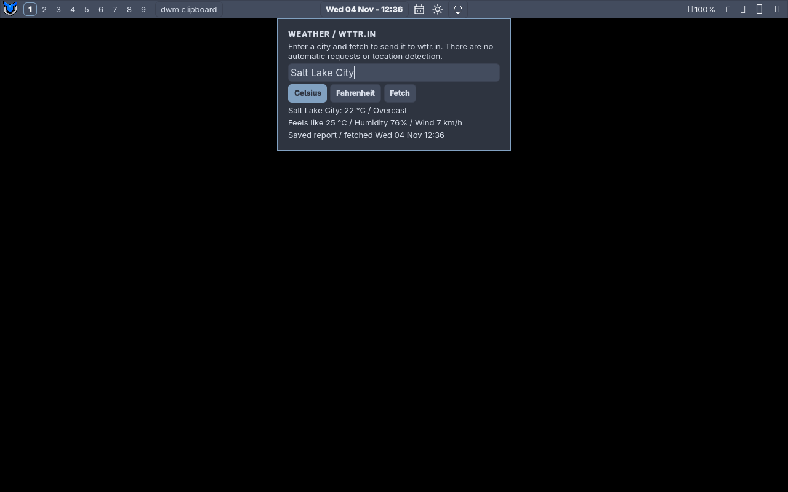

# Calendar and weather panel widgets

Both widgets are off by default. Enable them in Control Center > Bar Widgets
or Settings > Appearance > Panel widgets; visibility is shared across monitors.
Show all widgets explicitly enables them too. Existing panel settings retain
their choices when upgrading. Calendar and Weather use the regular theme,
Escape dismissal and click-away popup pattern; disabling a widget closes it.

Calendar shows a Monday-first six-week month grid, highlights today, and
supports previous/next month, Today, and Left/Right keys. It reuses the existing
clock timestamp and creates no additional clock or polling process.

Weather starts with no location. Enter a city, choose Celsius or Fahrenheit,
and press Fetch or Enter. This explicitly sends the city to wttr.in over HTTPS.
There is no IP geolocation, startup request, periodic refresh or network call
merely from opening the popup. City names are encoded into one fixed-host URL;
requests have a 12-second overall deadline and a 256 KiB response limit.
Redirects are rejected and only validated current-condition fields are displayed.

The service's [official JSON documentation](https://github.com/chubin/wttr.in#json-output)
describes the `format=j1` response. The optional widget requires no account or
API key. A service or network failure is reported while retaining the prior
report, city, units and fetch timestamp. Saved reports are explicitly labelled;
use Fetch for current conditions. This is a convenience display, with no severe
weather alerting or background monitoring.

The managed helper `dwm-weather status` only reads saved state.
`dwm-weather fetch 'Salt Lake City' c` explicitly requests and saves a report
(`f` selects Fahrenheit). State is private mode 0600 in
`${XDG_CONFIG_HOME:-$HOME/.config}/dwm-titus/weather-state.json`. Unsafe or
malformed state is preserved; move it aside to recover, then fetch again.
A checked process protocol keeps failed output from replacing a valid report.
No optional component is elevated and no package dependency is added.

## Validation

`make check-calendar-weather` runs backend success, parsing, permissions,
symlink, malformed-state, response-size, redirect and network-failure tests.
The nested X11 fixture runs real dwm and the Quickshell popups against a local
HTTP fixture using an injected test-only wrapper. It proves zero startup/open
requests, explicit Enter fetch, failure/cache behavior, persisted toggles,
leap-day and year-rollover navigation, Escape and click-away dismissal, closing
on disable and closed idle CPU. `DWM_FEATURE_EVIDENCE_DIR` captures screenshots.
The runtime fixture does not contact the public weather service or qualify
its availability. Physical multi-monitor popup placement remains a separate
hardware check; the shared panel popup host clamps content to its screen.

