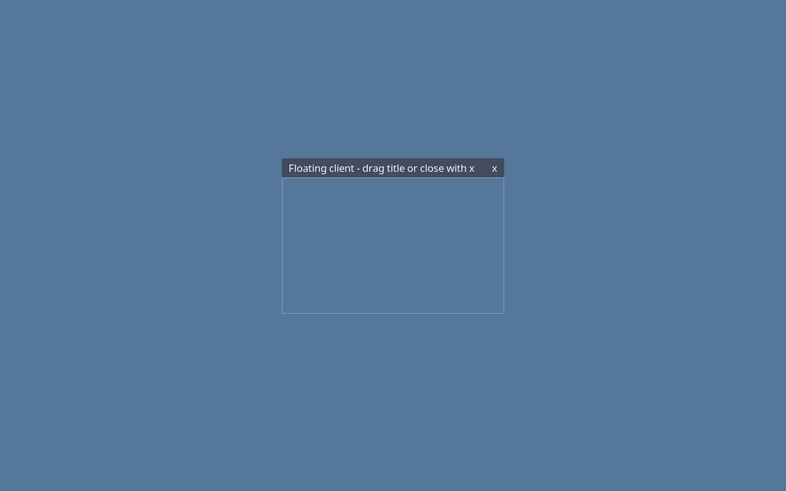

# Optional floating-window titlebars

For Wine applications, older games or other floating windows that need mouse
controls, add these keys to the existing `[appearance]` section in
`${XDG_CONFIG_HOME:-$HOME/.config}/dwm-titus/themes.toml`:

```toml
[appearance]
titlebars = 1
titlebar_tags = 511
```

Edit the existing section rather than adding a duplicate. Existing accounts
without these keys keep titlebars disabled. Fresh defaults also set
`titlebars = 0`. Save to use the existing hot reload; set `titlebars = 0` to
turn them off again. These settings do not require rebuilding, a compositor,
a new library, a privileged helper or an additional background process.

`titlebar_tags` is a workspace bit mask: 1 is workspace 1, 2 is workspace 2,
4 is workspace 3, and so on; add the values for the desired workspaces. For
example 3 allows workspaces 1 and 2, and 511 allows all nine. Zero allows none.
With a multi-tag window, a titlebar appears only when one of its currently
visible assigned workspaces is allowed. Bits outside a custom compiled tag set are ignored. Invalid values retain the last valid
configuration and report the configuration problem.

Titlebars appear on individually floating windows and in the floating layout.
Drag the title text to move the existing window; click x to request its normal
close. Applications supporting WM_DELETE_WINDOW receive that protocol message;
others use dwm's existing X11 client-close fallback. This never uses an
application-supplied PID. A titlebar does not change tags, monitor ownership,
window rules, tiling shortcuts or application rendering resolution.

The native X11 strip follows the application geometry and sits immediately
above it, below any higher-stacked application or popup. The client is not
reparented. The work-area clamp keeps the titlebar reachable above the client.
Applications with minimum sizes larger than the available work area retain
their existing size hints. Tiled windows and real/windowed fullscreen remain
undecorated, and tag switches hide the strip with its client. The active dwm theme
supplies its colors; the strip uses dwm's configured Xft font. Decorations are destroyed when a client closes.

## Validation

`make check-titlebars` runs real dwm on private one-monitor and two-monitor
Xinerama servers. The native fixture checks disabled defaults, floating versus
tiled behavior, title/body geometry, application-driven movement, actual mouse
dragging, workspace policy changes, fullscreen entry/exit, layout changes,
WM_DELETE_WINDOW delivery and decoration cleanup. A tall Xvfb root with a
test-only Xinerama shim checks an actual drag from a lower virtual monitor to
an upper one. Fullscreen restoration reserves titlebar clearance without
constraining interactive monitor changes. The fixture samples idle dwm CPU.
`DWM_FEATURE_EVIDENCE_DIR` saves a screenshot. The existing native runtime,
monitor/tag, keyboard and aggregate gates cover integration. Physical monitor
hotplug, Wine applications and GPU hardware still need separate qualification.


