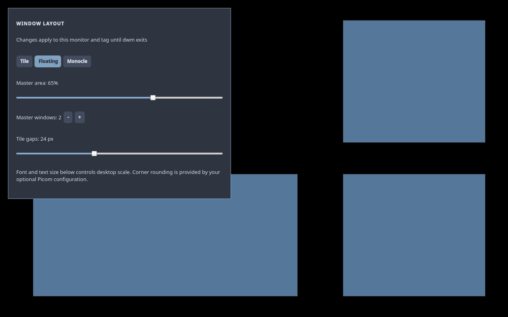

# Visual layout and scale settings

Open `dwm-settings`, choose Appearance and find Window layout. Select Tile,
Floating or Monocle; set the master area's percentage and number of master
windows; drag Tile gaps to add spacing in the tile layout. Keyboard layouts
and window layouts are separate controls.

Layout, master sizing and gaps belong to the selected monitor and tag for the
current dwm session. Switching tags restores their choices. Gaps start at zero,
including after a dwm restart; existing hotkeys and user TOML files are preserved.
Dense views clamp effective gaps so spacing cannot consume the entire screen.
Floating and Monocle do not use tile gaps.

Font and text size follows these controls in Appearance. It retains the existing
preview, apply, reset and rollback workflow for desktop scale. Some applications
must reopen to pick up scale changes. Optional Picom configuration supplies
window corner rounding; dwm does not require a compositor.

## X11 interface

`_DWM_LAYOUT_STATE` is an INTEGER/32 root property with nine values: monitor
number, visible tag mask, semantic layout ID, master percent, master count, tile gaps,
protocol version (3), per-tag settings owner (0 means the all-tag state),
and a supported-layout bit mask (bits 0/1/2: Tile/Floating/Monocle). dwm publishes only changed values.

`_DWM_LAYOUT_REQUEST` is a 32-bit root ClientMessage containing operation,
integer value, monitor number, visible tag mask and a final word containing version 3 in the low 16 bits
and settings owner in the high 16 bits. Operations are
semantic layout choice (0), master percent (1), master count (2) and gap (3). Ranges are 0-2 for
the shipped layouts, 5-95 percent, 0-20 master windows and 0-64 pixels. dwm
maps choices to their arrange functions regardless of custom config.h ordering or
array size; unknown custom layouts have ID -1 and unavailable choices are hidden. It
rejects invalid values and requests for a different current monitor or view.

The unprivileged `dwm-layout-settings status` command emits one JSON snapshot;
`watch` streams changed snapshots using X11 events. `set SETTING VALUE MONITOR
TAGMASK OWNER` waits up to two seconds for the requested state and fails on a stale
view, including the same visible tag mask reached from a different owner. A shell running against an older dwm explains that a session restart is
needed. No new package dependency, polling timer, elevated helper or persistent
settings file is introduced. The watcher stops when Appearance closes.

## Validation

`make check-layout-settings` runs a real dwm and the QML pane on private single-
and two-monitor Xinerama servers inside private D-Bus sessions. It exercises layout choices, slider values,
master endpoints, recovery from hotkey counts above 20, gap geometry, tag restoration, invalid/stale requests,
mouse-equivalent QML actions, hotkey convergence and watcher reopening, and
samples idle CPU. `make check-xvfb-runtime` retains the existing desktop smoke
coverage. Physical monitor hotplug and GPU/compositor behavior need separate
hardware qualification.

