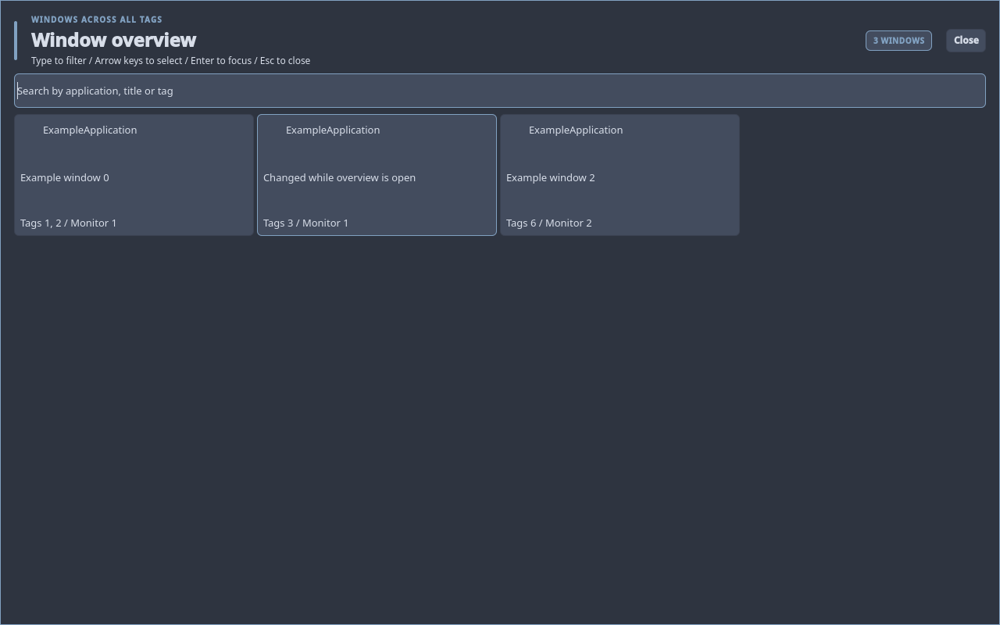
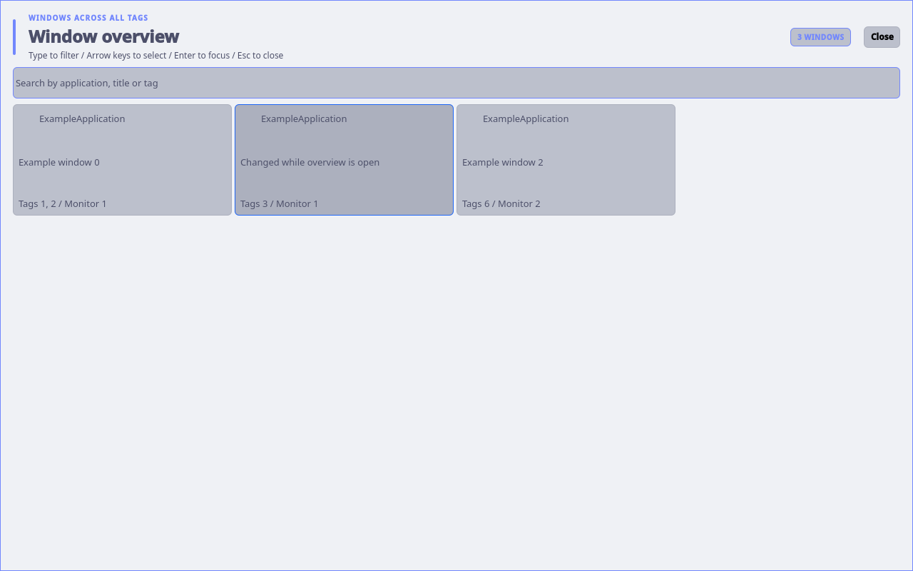

# Window overview

Press `Super+Tab`, or choose Window overview in Control Center or the command menu. The fullscreen
view contains one card per managed application window across all tags, including
several windows from the same application. Each card shows a static thumbnail and identifies the title,
application, complete tag list and owning monitor. Type to filter by application,
title or tag. Use Tab/Shift+Tab, Up/Down, or Left/Right with an empty search,
then Enter; clicking a card selects it directly. Escape or Close dismisses the
view and restores previous focus. The empty and no-match states are explicit.

Selection does not change a window's tags or monitor. dwm chooses its actual
monitor and retains that monitor's visible tag if it already contains the
window; otherwise it selects the lowest assigned tag on that monitor, then
focuses and raises the selected window. Explicit selection exits another visible
fullscreen client on that monitor when it would cover the selection. A closed window produces an actionable
error and the overview can be reopened. The overview tracks open, close, title
and tag changes through X11 events. Thumbnails are captured once per opening,
including windows on hidden tags, and stay unchanged through searches, title
changes and application repaints. Close and reopen to refresh them. Newly opened
windows appear with an icon until the next overview opening.

Capture runs outside dwm and Quickshell in a disposable helper process. It reads
the compositor's existing XComposite window pixmaps, scales them with XRender
to at most 320x180 before reading pixels back, and writes private PNGs in a
unique temporary directory. It never switches tags, raises windows or changes
compositor redirection. Each opening captures at most 64 windows within a
three-second batch budget. A missing compositor/library, an unredirected or
closed window, or an exhausted budget leaves the icon/title card usable.
Picom is included in the desktop profile; thumbnails need it or another running
X11 compositor. There is no capture polling or live updating. Closing cancels
capture and removes the temporary images; Qt image caching is disabled.

`dwm-window-overview open`, `toggle` and `close` use the managed Quickshell IPC
instance. The shipped `Super+Tab` binding invokes `dwm-window-overview toggle`
in place of the former Previous tag binding. Existing user hotkey files are
preserved by installation; update only that entry in `hotkeys.toml` to migrate:

```toml
{ mod="SUPER", key="Tab", desc="Window overview", func="spawn", exec=["dwm-window-overview", "toggle"] },
```

Other custom hotkeys can invoke the same helper. `list` prints a JSON snapshot including active client; `watch` streams
changed snapshots while subscribed; `activate XID` validates membership and
waits up to two seconds for a per-request acknowledgement. This also supports
clients with Input=false and WM_TAKE_FOCUS. Internal `restore XID` restores focus on
cancellation only while the client remains visible, without switching tags or
exiting a fullscreen peer. `context PID` returns the most recently focused visible
client outside that process on the selected monitor, including when a shell
surface currently has focus. `list` and `watch` accept `--exclude-pid PID`.
`watch --thumbnails` additionally captures one opening snapshot; ordinary `list`
and `watch` remain metadata-only. The GUI excludes its own shell process using window PID metadata, never an
application title. The backend uses Python's standard library
and libX11, with bounded property and client-list reads (4096 windows maximum).
Thumbnails load libXcomposite and libXrender through ctypes; these are already
provided by the desktop's Picom/X11 dependencies. No C-core dependency is added.

The C core only publishes versioned full-tag and monitor metadata and handles
a bounded explicit activation request. Search, cards, keyboard navigation and
application labels stay in Quickshell. The helper and window delegates exist
only while the overview is visible. An older running dwm reports that a session
restart is required.

## Interface

- `_DWM_WINDOW_OVERVIEW` on the root: CARDINAL/32 version 2.
- `_DWM_CLIENT_INFO` on each managed client: CARDINAL/32 values version (1),
  full tag mask and dwm monitor number. Docks and unmanaged overlays have no
  such metadata and are omitted.
- `_DWM_WINDOW_ACTIVATE`: root-directed ClientMessage/32 naming the client in
  `window` (root for context), version 2 in `data.l[0]`, mode 0 (select),
  1 (restore visible focus only) or 2 (context) in `data.l[1]`, and the caller's
  private unmapped reply-window XID in `data.l[2]`. Context supplies the process
  ID to exclude in `data.l[3]` and scans at most 4096 focus-stack entries.
- `_DWM_WINDOW_RESULT` on the reply window: CARDINAL/32 values version (2),
  mode, selected/context client XID (zero for no context), and handled status
  (1 success, 0 rejected). Distinct reply windows prevent stale or concurrent
  requests satisfying one another. The helper destroys its reply window on
  success, rejection or timeout. The ordinary `_NET_ACTIVE_WINDOW` and
  WM_TAKE_FOCUS policies are preserved.

## Validation

`make check-window-overview` runs real dwm and Quickshell on private one-monitor
and two-monitor Xinerama servers. It covers individual same-application cards,
multiple tags, titles changing while open, keyboard and actual mouse selection,
Escape focus restoration, multi-tag assignment preservation, closing before
selection, fullscreen occlusion, swallowing/restoration metadata, malformed optional title metadata and the empty state. An 80-card
UI fixture checks scrolling to the final row. The production-shell fixture also
checks title collisions, cancellation over Launcher/Menu/Clipboard, a hidden
selection with an earlier tiled peer, and Input=false/WM_TAKE_FOCUS activation.
The fixtures also verify actual pixels on hidden tags, fixed images during
repaints/search/title events, fresh images on reopening, private cache permissions,
cleanup on closing, and isolation of a closed-window capture failure. The
production fixture exercises the usable fallback without a compositor.
The fixtures sample idle CPU. Set
`DWM_FEATURE_EVIDENCE_DIR` to save dark and shipped light-theme screenshots.
Physical hotplug, distinct physical display arrangements and GPU behavior still
need hardware qualification; the two-screen fixture uses Xvfb Xinerama.

The repeatable performance comparison and its limits are recorded in
[the thumbnail benchmark](validation/issue-350/THUMBNAIL-BENCHMARK.md).




