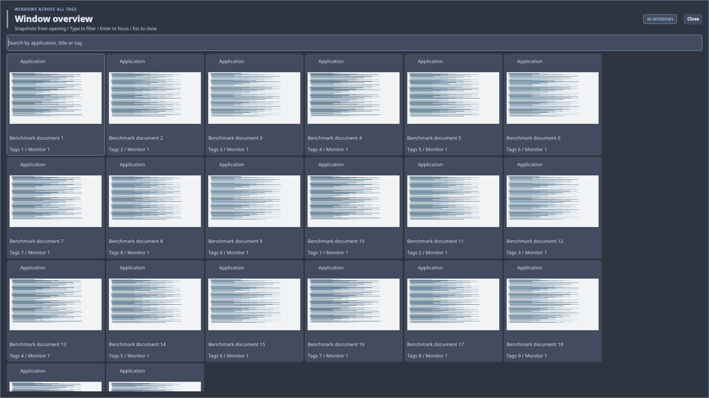

# Static window thumbnail benchmark

Measured on 2026-11-04, Fedora 44 x86_64, Intel Core i7-12700H,
Quickshell 0.2.1 (Fedora revision dacfa9de829ac7cb173825f593236bf2c21f637e),
Picom v13 with XRender, Xvfb and Qt's software renderer. These are nested X11
measurements on a working desktop, not physical GPU frame-rate or VRAM results.

The reference is PR 425 commit `0cae78af16cc2c0a94befe62eac092fe013624be`
(text cards). The candidate adds opening-only thumbnails. Both use the same
unchanged dwm binary and 20 deterministic document-like fixture windows, spread
across nine tags. The source windows and Xvfb desktop are either 1920x1080 or
3840x2160. The screenshot below contains only these synthetic applications.



## Results

Each row is 20 measured openings per variant after two warmups. A second run
reverses variant order; there are 40 measured openings per variant/resolution.
Wall times below are medians; p95 is the nearest-rank percentile of the raw
samples. "Ready" means all window rows and instantiated thumbnail images have
loaded, observed by a 5 ms QML test timer. It does not measure presentation on a
physical display. The timer and memory sampler exist only in the benchmark.

| Source/desktop | Order | Text ready median / p95 | Thumbnail ready median / p95 | Additional median time | Additional median CPU time |
| --- | --- | --- | --- | --- | --- |
| 1080p | Text first | 192.5 / 222 ms | 436.5 / 513 ms | 244 ms | 290 ms |
| 1080p | Thumbnails first | 147.5 / 223 ms | 326 / 529 ms | 178.5 ms | 210 ms |
| 4K | Text first | 176 / 234 ms | 311.5 / 536 ms | 135.5 ms | 150 ms |
| 4K | Thumbnails first | 148 / 326 ms | 264.5 / 333 ms | 116.5 ms | 135 ms |

The overview model becomes visible before capture finishes: candidate medians
were 54-103.5 ms, versus 60-90.5 ms for text cards. Search, navigation and closing
remain available while the worker captures. The variation between runs shows
why these results should not be converted into a general FPS-loss percentage.

CPU time sums Quickshell, its helper descendants, dwm, Picom and Xvfb, including
reaped helper children. It uses Linux process counters at 10 ms resolution;
cumulative CPU time can exceed wall time. Benchmark IPC handling is included.

| Source/desktop | Additional median open shell/helper RSS | Additional median peak shell/helper RSS |
| --- | --- | --- |
| 1080p, both orders | 18.9-20.4 MiB | 44.9-46.9 MiB |
| 4K, both orders | 19.0-19.7 MiB | 45.8-46.4 MiB |

RSS is sampled every 5 ms and summed over Quickshell and its helper processes,
so it counts shared pages more than once and can miss brief peaks. Peak includes
the disposable capture interpreter; open RSS is sampled after its exit. Raw
results also contain whole-stack RSS, but X server/Picom allocator retention
across variants makes it unsuitable as an isolated thumbnail-memory estimate.
These values do not measure GPU memory. The 20 PNGs total 45-55 KiB for this
compressible fixture; photographic content will compress differently. A single
RGBA copy of twenty maximum-size 320x180 thumbnails is about 4.4 MiB.

Two-second idle samples measured 0-20 ms of CPU while open, and 0 ms while closed,
across the monitored stack (10 ms counter granularity). There is no capture
refresh loop; ordinary metadata tracking and the search cursor remain active
while open. No worker or capture work is kept running after close.

## Implementation and acceptance

- Read existing XComposite pixmaps, downscale through XRender before CPU
  readback, and release each named full-size pixmap immediately.
- Capture once per opening, up to 64 windows with a three-second batch budget.
  No redirection changes, tag switches, window raising or dwm capture code.
- Keep thumbnails fixed during repaints, title events and searches. New clients
  have icon cards until the next opening. Missing/unredirected/closed windows
  and unavailable compositor libraries use the same fallback.
- Use per-opening private temporary directories (0700), PNG files (0600), atomic
  publication and uncached asynchronous Qt images. Closing kills/reaps an
  unfinished worker, removes its files, and rejects late snapshots.
- Mono/dual-monitor Xvfb tests verify actual hidden-tag pixels, refresh on
  reopening, unchanged images during repaints/search/title events, permissions,
  close cleanup, failure isolation and cancellation of a deliberately paused
  worker. The production-shell fixture exercises compositor-free fallback and
  cancellation over Launcher, Menu, Clipboard, Settings and System Health.

[XComposite's documented named-pixmap behavior](https://xorg.freedesktop.org/archive/X11R7.5/doc/man/man3/Xcomposite.3.html)
explains why capture needs an existing redirected window and why references must
be freed promptly. Picom is part of the desktop profile; a desktop without a
running compositor retains usable icon/title cards.

## Reproduce

Use a private Xvfb display, not the live desktop. Install the supported Fedora
build/test dependencies plus Picom and Python Pillow for an optional screenshot.
From the repository root:

```sh
scripts/run-tests make all
scripts/run-tests dbus-run-session -- xvfb-run -a -s '-screen 0 1920x1080x24' \
  python3 tests/benchmark-window-overview.py --iterations 20 \
  --output "$HOME/tmp/overview-1080.json"
scripts/run-tests dbus-run-session -- xvfb-run -a -s '-screen 0 1920x1080x24' \
  python3 tests/benchmark-window-overview.py --reverse-order --iterations 20 \
  --output "$HOME/tmp/overview-1080-reverse.json"
scripts/run-tests dbus-run-session -- xvfb-run -a -s '-screen 0 3840x2160x24' \
  python3 tests/benchmark-window-overview.py --width 3840 --height 2160 --iterations 20 \
  --output "$HOME/tmp/overview-4k.json"
scripts/run-tests dbus-run-session -- xvfb-run -a -s '-screen 0 3840x2160x24' \
  python3 tests/benchmark-window-overview.py --reverse-order --width 3840 --height 2160 --iterations 20 \
  --output "$HOME/tmp/overview-4k-reverse.json"
```

Add `--screenshot "$HOME/tmp/overview-thumbnails.png"` to save a fixture screenshot.
Managed workspaces and fixture processes are removed on exit. Only the explicitly
requested output JSON/screenshot remains.

Raw samples and runtime-source SHA-256 manifests:

- [1080p, text first](thumbnail-benchmark-1080.json)
- [1080p, thumbnails first](thumbnail-benchmark-1080-reverse.json)
- [4K, text first](thumbnail-benchmark-4k.json)
- [4K, thumbnails first](thumbnail-benchmark-4k-reverse.json)

Measurements preceded the implementation commit, so `candidate_head` identifies
the starting checkout and `candidate_uncommitted` is true. The
`candidate_sources_sha256` entries match the submitted helper and both overview
QML files. Summaries were regenerated from recorded samples with the final
nearest-rank p95 calculation. Hardware GPU/GLX behavior, driver-specific stalls,
physical multi-monitor arrangements and game/video FPS remain unmeasured.
